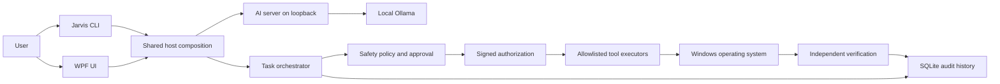

# Jarvis

Jarvis is a local-first Windows assistant. It turns a natural-language request into allowlisted tool calls, asks for approval when policy requires it, and reports success only after independent verification.

## Safety and verification in 10 lines

1. The planner returns structured tool IDs and arguments, never shell commands.
2. Every plan is validated against the tool registry and schema.
3. Policy computes the authoritative risk; model-supplied risk is advisory only.
4. Paths and application images are restricted by configured policy.
5. Approval defaults to deny; only existing Debug low-risk policy may auto-approve.
6. Each execution requires a signed, expiring, single-use authorization.
7. Executors consume the signed authorization and do not accept bypass flags.
8. The verifier independently checks operating-system state, not executor-reported success.
9. A task is complete only when its required verification succeeds.
10. The host and AI server communicate over loopback; Ollama is local.

## Architecture



The UI is another host for the same orchestrator, not a separate execution path. Project boundaries and invariants are described in [docs/DESIGN.md](docs/DESIGN.md).

## Quick start

Prerequisites: Windows 10/11, .NET 10 SDK, Python 3.11, and local Ollama. Run PowerShell from the repository root:

```powershell
.\scripts\setup-windows.ps1
dotnet run --project windows-host\src\Jarvis.Cli\Jarvis.Cli.csproj -- doctor
```

The setup script installs/configures Python dependencies and checks Ollama. It may install missing prerequisites. Review it before running if you do not want it to install software.

## Commands

```powershell
# Run a natural-language task (Jarvis plans, applies policy, requests approval, executes, and verifies)
dotnet run --project windows-host\src\Jarvis.Cli\Jarvis.Cli.csproj -- run "create a file named notes.txt"

# Show persisted task and audit history
dotnet run --project windows-host\src\Jarvis.Cli\Jarvis.Cli.csproj -- history

# Check local prerequisites and service health
dotnet run --project windows-host\src\Jarvis.Cli\Jarvis.Cli.csproj -- doctor

# Build and launch the WPF host
dotnet run --project windows-host\src\Jarvis.UI\Jarvis.UI.csproj
```

For approval dialogs, review the canonical arguments and risk before deciding. Denial and closing the approval dialog both fail closed.

For a verified file search, the CLI and the UI's **Verified search results** tab show paths independently enumerated by the verifier. The CLI no longer prints executor stdout in task summaries; exit codes and error text are labeled untrusted diagnostics. A verified search result is an observation at verification time, not a guarantee that files will remain unchanged.

## Tests and checks

Run the repository gate in a normal desktop session:

```powershell
.\scripts\check-all.ps1
```

The gate builds and tests the .NET solution and runs Python tests, Ruff, mypy, and format verification. It also opts into the `RealScheduler` test category; those tests may register real per-user scheduled tasks. To run only non-real scheduler C# tests:

```powershell
dotnet test windows-host\Jarvis.sln --configuration Release --filter "Category!=RealScheduler"
```

## Evaluation reproduction

The development fake-scheduler smoke is reproducible from the repository root after a Release build:

```powershell
dotnet build windows-host\Jarvis.sln --configuration Release
dotnet windows-host\src\Jarvis.Eval\bin\Release\net10.0-windows\Jarvis.Eval.dll run --seed 20261025 --reps 1 --smoke --scheduler fake --out docs\eval\results\dev-run-4
```

The development run is not the frozen paper evaluation. The five-repetition paper run is governed by [docs/eval/PROTOCOL.md](docs/eval/PROTOCOL.md) and must be reproduced from the unchanged `eval-paper-v1` tag using the protocol's commands and output locations. Do not edit the evaluation protocol or its expected-verdict table.

## Limitations

- Verification stages 7 and 8 are deferred to Phase 6 and currently report `NOT_RUN`.
- Filesystem evidence snapshots are non-recursive and do not claim to observe all descendant or unrelated changes.
- Search enumeration skips reparse-point directories and escalates if a matching file is a reparse point. This check is a point-in-time observation and does not prevent subsequent filesystem changes.
- Notepad resolution supports the configured/packaged Windows locations described by the project; arbitrary installations are not guaranteed to resolve.
- Real Task Scheduler tests are opt-in and require `JARVIS_REAL_SCHEDULER=1`; fake-scheduler tests are the default for evaluation.
- The evaluation uses a small fixed catalogue and synthetic faults; it does not establish performance or reliability for every Windows workload.
